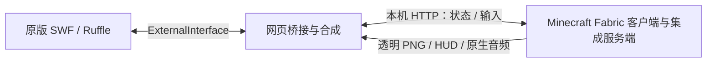

# 架构与权威划分

三个部分都实际运行。原游戏负责街道、镜头、敌人生成与原始 AI、Boss/关卡流程及原画。MC 负责史蒂夫原生移动、生命、装备、物品使用、方块、实体以及跨引擎战斗中的 MC 伤害结果。网页负责传输输入、状态和画面呈现。

## 一个状态只设一个最终决定方

| 状态 | 权威 |
|---|---|
| 原版场景、镜头、检查点和敌人生成/移动 | SWF |
| 史蒂夫位置、生命、装备、原生战斗结算 | MC |
| 新放方块、原生生物、流体 | MC |
| Flash 敌人原生受击动画与死亡呈现 | SWF 接收 MC 结果后执行 |
| 输入、缩放、画面时间对齐 | 网页 |

这不是把两边物理完整合并为一个物理引擎。原敌人继续由原始逻辑移动；MC 用战斗代理与之交互，原游戏玩家代理被同步到史蒂夫位置用于维持原敌人的目标及接触逻辑，不再独立决定玩家移动。

## 一次完整循环

1. `brawler.as` 导出场景 ID、原游戏角色/物体、街道碰撞与受击事件。
2. 网页读 `mcState`，将该快照 POST 到 MC `/state`。
3. 集成服务端创建或更新街道碰撞和敌人代理，处理输入、物品及伤害。
4. MC 返回位置、生命、代理损伤、方块和实体状态。
5. 网页调用 `mcPosition` / `mcApply`，让原游戏代理、动画及战斗反馈跟随结果。
6. 客户端导出玩家、方块/实体、HUD 和界面透明 PNG；网页与 SWF 合成。

原游戏敌人攻击玩家时先进入桥接事件队列；MC 决定史蒂夫受到的原生伤害。反向攻击通过 MC 的代理对象得到伤害结果，再驱动原版敌人的反馈。这里有针对原游戏血量单位、敌人无敌期和受击动画的适配，不能直接套给其他游戏。

## 为什么本例使用 X/Z 平面

狂扁小朋友是在街道上四向移动的斜视角游戏。Flash 的 X/Y 映射到 MC 的 X/Z，MC 的 Y 用于跳跃和高度。不同于平台跳跃游戏将 Flash Y 直接映射到 MC 高度的适配。

## 场景生命周期

`scene` 隔离重开后的旧状态；无有效 Flash 快照超过约 2 秒时，MC 主循环冻结玩家桥接运动。`ReplayReset` 处理重开清理，`travelAck` / `hitAck` 对齐阶段移动与原版伤害事件。音频也按场景隔离。

## 通用部分与游戏适配部分

HTTP、输入、原生界面、图像导出和声音回传具有复用价值；`brawler.as`、敌人/街道坐标、攻击判定、检查点和 Boss 生命周期属于本游戏适配。当前源码保留了早期通用模块与本游戏扩展，文件名仍有历史命名，未声称全部模块均经过此游戏验证。
